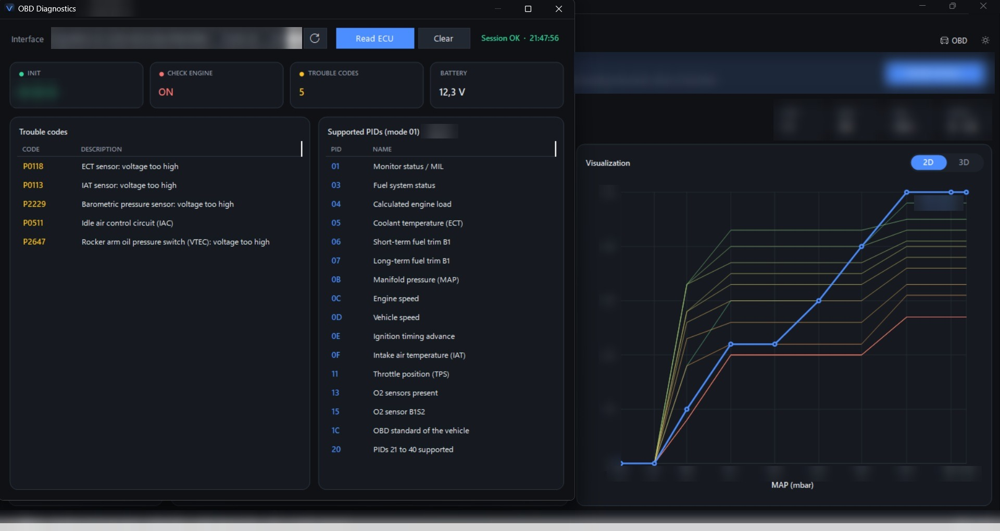
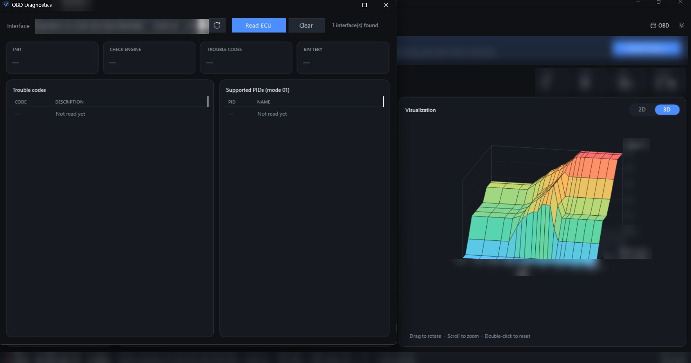

<a href="README.md">🇫🇷 Français</a> · <b>🇬🇧 English</b>

  <picture>
    <source media="(prefers-color-scheme: dark)" srcset="assets/logo-dark.png">
    <source media="(prefers-color-scheme: light)" srcset="assets/logo-light.png">
    
  </picture>

Calibration and reflashing software for Honda K-series ECUs

  
  
  
  

“Vectune” is a working title: the name may change before the official release.

---

## 🔎 About

**Vectune** is a Windows application in development, designed for calibrating and reflashing Honda K-series ECUs.

This project is the result of **several years of work**, done in spare time, out of passion.

> 🔒 **Personal-use project for now.** The software is not distributed and is not available to the public.

This repository is the **project showcase**: it follows progress, screenshots and announcements. The source code is not public.

> 🎁 **Coming soon: a free version!**
> We are currently working on a **completely free** version of the software, dedicated to **diagnostics** (trouble code reading) and **live data tracking**. It will be available soon.
>
> 🔌 Diagnostics will work directly through the vehicle's **OBD2 port**, using a **Tactrix OpenPort 2.0** interface.

---

## 📸 Preview

   
  Diagnostics: trouble code reading, with the 2D view of a calibration table

   
  3D view of a calibration table (mouse rotation and zoom)

Some technical details have been intentionally hidden.

---

## ✨ Features

- Calibration table editing
- 2D and 3D visualization
- Open and save calibrations
- Trouble code reading
- Dark / light theme

---

## 🗺️ Roadmap

- [x] Calibration editor
- [x] Basic diagnostics
- [ ] Free version: diagnostics and live data *(coming soon)*
- [ ] Datalogging
- [ ] ECU reading
- [ ] ECU reflashing

Details for each version are in the [changelog](CHANGELOG.md) (in French).

---

## ⚠️ Disclaimer

Project in development. Any work on an ECU carries risks. Use at your own risk.

Honda, Acura, K-series, Tactrix and OpenPort are trademarks of their respective owners. Vectune is not affiliated with or endorsed by these companies.

---

## © License

© 2026 Ferlandez. All rights reserved. See the [LICENSE](LICENSE) file.
