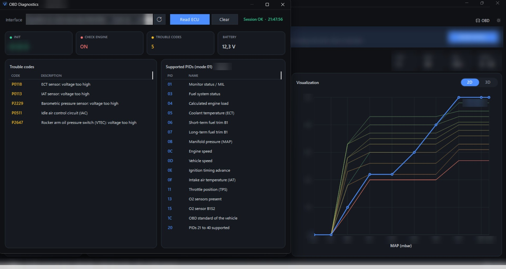
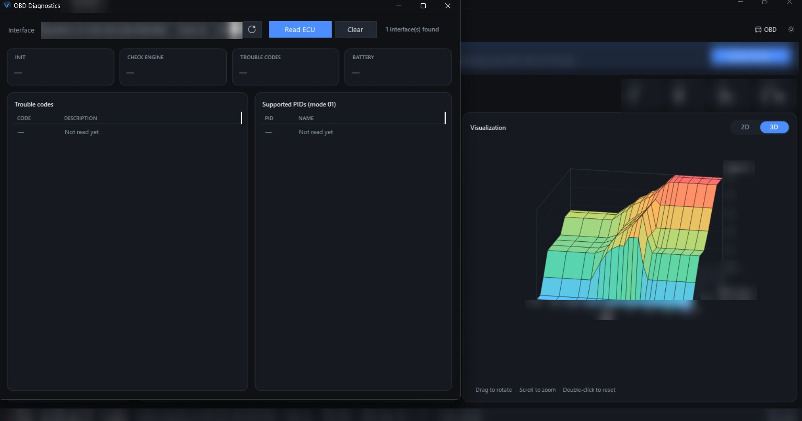

<b>🇫🇷 Français</b> · <a href="README.en.md">🇬🇧 English</a>

<h1 align="center">Vectune*</h1>

  <b>K-Series Calibration Suite</b> 
  Logiciel de calibration et de reprogrammation pour ECU Honda K-series

  
  
  
  

* Nom de travail provisoire : le nom du logiciel pourrait changer avant sa sortie officielle.

---

## 🔎 À propos

**Vectune** est un logiciel Windows en développement, destiné à la calibration et à la reprogrammation des ECU Honda K-series.

Ce projet est le fruit de **plusieurs années de travail**, mené à temps perdu, par passion.

> 🔒 **Projet à usage personnel pour le moment.** Le logiciel n'est pas distribué et n'est pas offert au public.

Ce dépôt est la **vitrine du projet** : on y suit l'avancement, les captures d'écran et les annonces. Le code source n'est pas public.

> 🎁 **Bientôt : une version gratuite !**
> Nous travaillons actuellement sur une version **entièrement gratuite** du logiciel, dédiée au **diagnostic** (lecture des codes défaut) et au **suivi des données en temps réel** (live data). Elle sera disponible sous peu.

---

## 📸 Aperçu

   
  Diagnostic : lecture des codes défaut, avec la visualisation 2D d'une table de calibration

   
  Visualisation 3D d'une table de calibration (rotation et zoom à la souris)

Certains détails techniques ont été volontairement masqués.

---

## ✨ Fonctionnalités

- Édition des tables de calibration
- Visualisation en 2D et en 3D
- Ouverture et enregistrement des calibrations
- Lecture des codes défaut
- Thème sombre / clair

---

## 🗺️ Feuille de route

- [x] Éditeur de calibration
- [x] Diagnostic de base
- [ ] Version gratuite : diagnostic et données en temps réel *(bientôt)*
- [ ] Datalog
- [ ] Lecture de l'ECU
- [ ] Reprogrammation de l'ECU

Le détail de chaque version est dans le [journal des changements](CHANGELOG.md).

---

## ⚠️ Avertissement

Projet en développement. Toute intervention sur un ECU comporte des risques. Utilisation à vos propres risques.

Honda, Acura et K-series sont des marques de leurs propriétaires respectifs. Vectune n'est ni affilié à Honda, ni approuvé par Honda.

---

## © Licence

© 2026 Ferlandez. Tous droits réservés. Voir le fichier [LICENSE](LICENSE).
